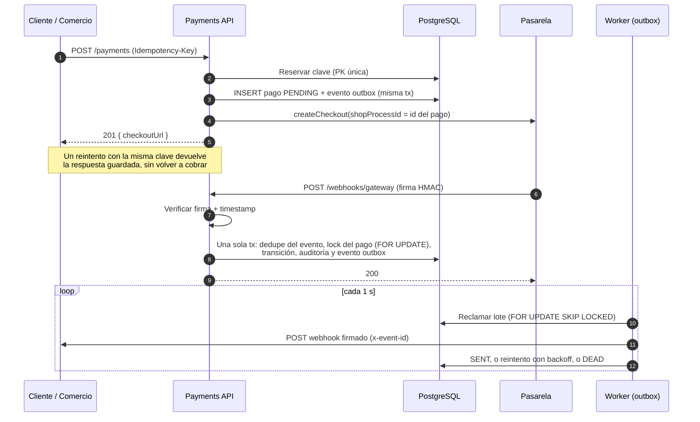
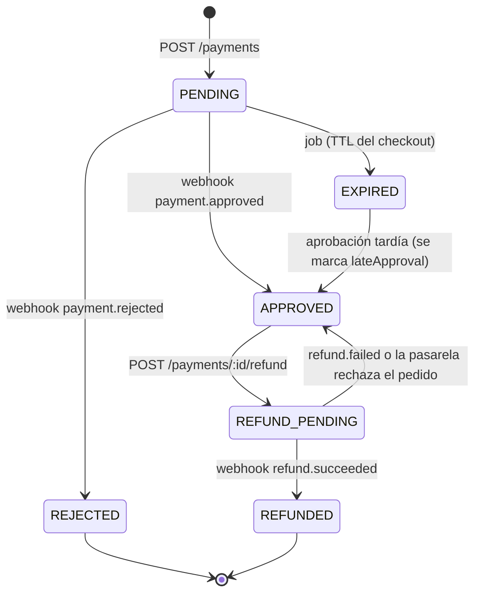
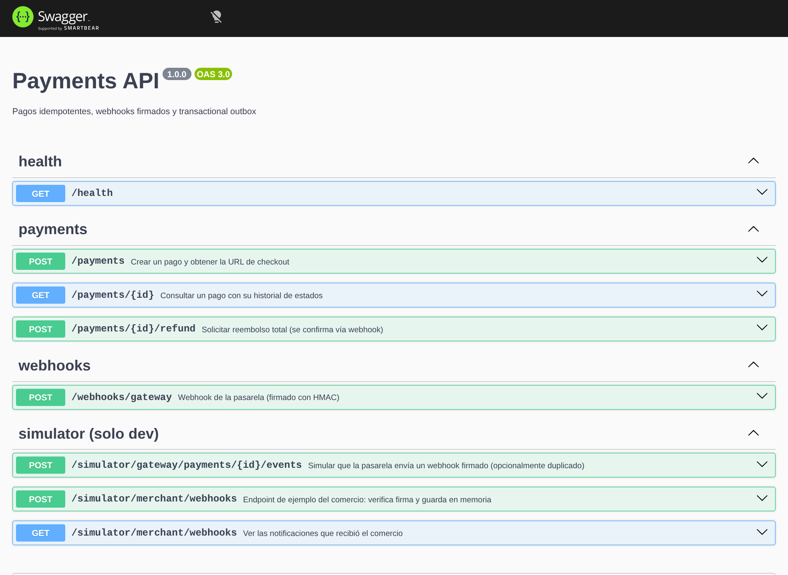
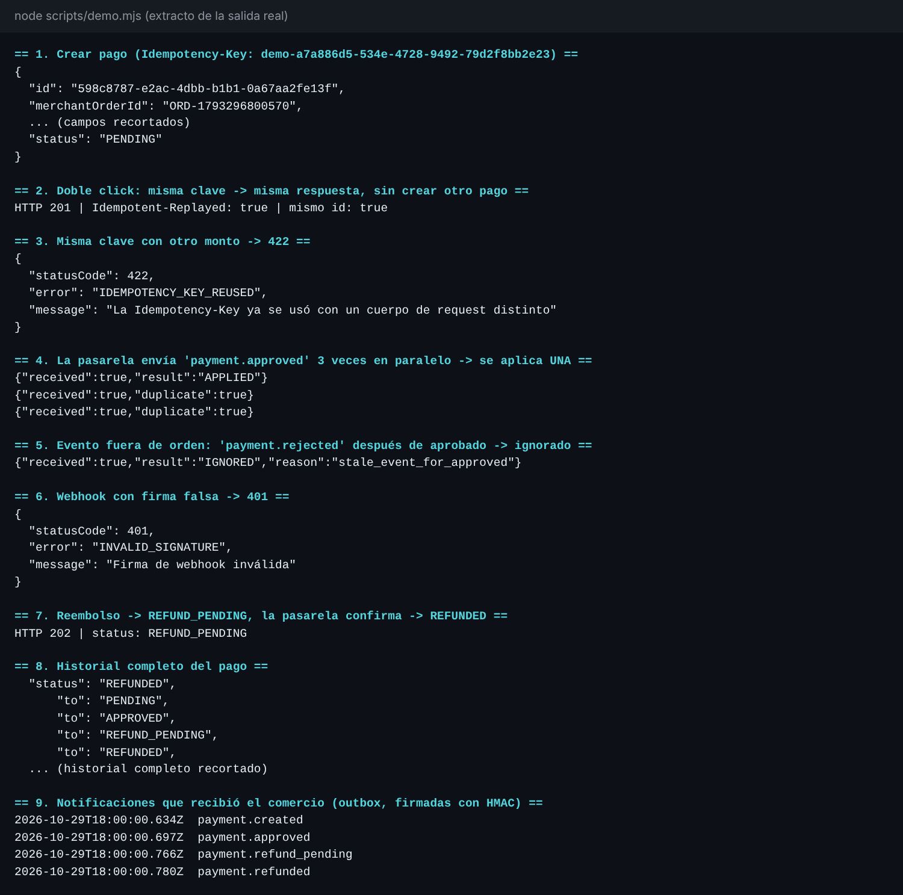

# Payments API: cobros que nunca se duplican

API de pagos construida con **NestJS + PostgreSQL**. Resuelve los problemas que aparecen cuando se integra una pasarela real: dobles cobros, webhooks duplicados o fuera de orden, notificaciones que se pierden y pagos que quedan colgados.


> **Stack:** NestJS 11 · TypeScript (strict) · PostgreSQL 16 · Drizzle ORM · Jest + Supertest · Docker · GitHub Actions
> **Tests:** 26 unitarios + 31 e2e contra PostgreSQL real, incluidos tests de concurrencia.

---

## El problema

Un comercio integra una pasarela (Bancard, Pagopar, Stripe…). En producción pasa esto:

| Situación real | Consecuencia si no se diseña bien |
|---|---|
| El usuario toca "Pagar" dos veces, o el móvil reintenta por un timeout | **Dos cobros** al mismo cliente |
| La pasarela reenvía el mismo webhook 3 veces (es *at-least-once*) | Pago procesado varias veces, stock descontado dos veces |
| Llega `rejected` después de `approved` (los webhooks no garantizan orden) | Un pago cobrado queda marcado como rechazado |
| Alguien descubre la URL del webhook y envía un `approved` falso | **Pedidos entregados sin cobrar** |
| El cliente paga justo cuando el checkout expiraba | Dinero cobrado, pedido cancelado |
| Se aprueba el pago en la base de datos pero la notificación al comercio falla | El comercio nunca se entera y no despacha |
| La pasarela se cae a mitad de la request | Pago a medio crear, el cliente no sabe si reintentar |

## La solución, de un vistazo



### Máquina de estados



Cada transición queda registrada en `payment_transitions`: quién la hizo (`api`, `webhook` o `expiration-job`), cuándo y por qué. `GET /payments/:id` devuelve ese historial.

## Cómo se resuelve cada problema

### 1. Doble cobro → claves de idempotencia ([ADR-0001](docs/adr/0001-idempotencia-en-postgres.md))

Todo endpoint con efectos exige el header `Idempotency-Key`. La lógica está en [`idempotency.service.ts`](src/idempotency/idempotency.service.ts):

- La **PK `(scope, key)`** garantiza que, aunque lleguen 20 requests en el mismo milisegundo, solo una gana. Las demás reciben `409` con `Retry-After`, o la respuesta guardada si la primera ya terminó.
- Se guarda un **hash SHA-256 del body** (con claves ordenadas). Si se reutiliza la clave con otro body, la API responde `422`, porque es un bug del cliente.
- Las respuestas 4xx se guardan porque son deterministas. Ante un **5xx la clave se libera** para que el cliente pueda reintentar.
- Si el proceso muere con la clave tomada, otra request la recupera pasado `IDEMPOTENCY_LOCK_TIMEOUT_SECONDS` (compare-and-set sobre `locked_at`).
- **Defensa en profundidad:** `merchant_order_id` es `UNIQUE`. Aunque el cliente use *otra* clave para la misma orden, nunca se crean dos pagos.

### 2. Webhooks duplicados y fuera de orden

En [`webhooks.service.ts`](src/webhooks/webhooks.service.ts), todo ocurre en **una sola transacción**:

1. `INSERT ... ON CONFLICT DO NOTHING` sobre el id del evento. Si llegan duplicados en paralelo, el segundo espera el commit del primero y no hace nada.
2. `SELECT ... FOR UPDATE` del pago, que serializa cambios concurrentes sobre el mismo pago.
3. Reglas explícitas por tipo de evento: `payment.approved` solo aplica desde `PENDING` o `EXPIRED`. Un `rejected` que llega tarde se ignora y se audita (`stale_event_for_approved`).
4. **Se valida monto y moneda** contra lo que se cobró. Nunca se confía ciegamente en la pasarela.
5. Responde `200` incluso a eventos ignorados, para que la pasarela no reintente indefinidamente.

### 3. Webhooks falsificados → firma HMAC

[`signature.ts`](src/common/signature.ts) aplica el esquema `t=<timestamp>,v1=<hmac-sha256>`:

- Firma `timestamp.rawBody`, es decir, **los bytes exactos recibidos** (por eso `rawBody: true`). Un solo byte cambiado invalida la firma.
- Rechaza timestamps de más de 5 minutos, lo que **previene replay attacks**.
- La comparación usa `timingSafeEqual`, que no filtra información por tiempo.
- La verificación es un **Guard** que corre *antes* de validar el body: sin firma válida no se revela nada sobre el formato esperado.

### 4. Notificaciones perdidas → Transactional Outbox ([ADR-0002](docs/adr/0002-transactional-outbox.md))

El cambio de estado y el evento para el comercio se escriben **en la misma transacción**. Un worker separado ([`outbox.dispatcher.ts`](src/outbox/outbox.dispatcher.ts)):

- Reclama lotes con `FOR UPDATE SKIP LOCKED`, así **N workers en paralelo** nunca procesan el mismo evento (hay un test que lo prueba).
- Hace el HTTP **fuera** de la transacción, sin retener locks durante la red.
- Firma cada notificación con HMAC y envía `x-event-id` para que el comercio deduplique.
- Reintenta con **backoff exponencial con jitter** ([`backoff.ts`](src/common/backoff.ts)). Después de N fallos el evento pasa a `DEAD` para revisión manual.

### 5. Pagos abandonados y aprobaciones tardías

- Un job expira los pagos `PENDING` cuyo checkout venció. Re-lee cada pago con lock antes de expirarlo, por si justo llegó la aprobación.
- Si llega `approved` para un pago `EXPIRED`, **se acepta**: la pasarela es la fuente de verdad del dinero. Se marca `lateApproval: true` para que el comercio decida (despachar o reembolsar).

### 6. Pasarela caída

- `POST /payments` responde `502 GATEWAY_UNAVAILABLE` y **libera la clave**. El reintento con la misma clave encuentra el pago ya creado y solo reintenta el checkout. La pasarela deduplica por `shopProcessId`, así que tampoco hay doble checkout.
- En reembolsos se usan **dos fases con compensación**: `REFUND_PENDING` → llamada a la pasarela → si falla, se vuelve a `APPROVED` y se emite `payment.refund_failed`. Nunca se marca `REFUNDED` sin confirmación de la pasarela.

## Requisitos previos

| Herramienta | Para qué | Cómo verificarla |
|---|---|---|
| **Docker Desktop** (Engine + Compose v2) | Levanta PostgreSQL, API y worker | `docker --version` y `docker compose version` |
| **Node.js 22 o superior** | Script de demo y desarrollo sin Docker | `node -v` |
| **WSL 2** (solo Windows) | Lo usa Docker Desktop | `wsl --status` |

<details>
<summary><strong>Instalar todo en Windows (PowerShell como administrador)</strong></summary>

```powershell
wsl --install --no-distribution
winget install -e --id Docker.DockerDesktop
winget install -e --id OpenJS.NodeJS.LTS
```

Reiniciá la PC, abrí **Docker Desktop** y esperá a que diga *Engine running*. Para comprobar que todo funciona:

```powershell
docker run hello-world
```

Si `wsl --install` o el instalador de Docker fallan, casi siempre es porque PowerShell no está abierto **como administrador** (error 740) o porque la virtualización está desactivada en el BIOS (`(Get-CimInstance Win32_Processor).VirtualizationFirmwareEnabled` debe dar `True`).

</details>

## Probarlo en 1 minuto

Abrí una terminal en la carpeta del proyecto:

```bash
docker compose up --build        # Postgres + migraciones + API + worker (dejala abierta)
```

La primera vez tarda unos minutos. Está lista cuando el log del servicio `api` muestra `Nest application successfully started`. En **otra** terminal:

```bash
node scripts/demo.mjs            # recorre todos los escenarios de arriba
```

- Swagger: http://127.0.0.1:3000/docs
- Health: http://127.0.0.1:3000/health
- Para apagar: `Ctrl + C` y luego `docker compose down` (`-v` borra también los datos).

> Si `http://localhost:3000/docs` se ve en blanco en tu navegador, usá `127.0.0.1` en lugar de `localhost`. Es un tema de resolución de nombres del equipo, no de la API.



`scripts/demo.mjs` muestra el doble click, la clave reutilizada (422), el webhook triplicado aplicado una sola vez, el evento fuera de orden, la firma falsa (401), el reembolso completo con su historial y las notificaciones que recibió el comercio. Esta es la salida real (recortada):



### Sin Docker

Necesitás un PostgreSQL 16 propio:

```bash
cp .env.example .env             # ajustá DATABASE_URL
npm ci
npm run db:migrate:dev
npm run dev                      # API
npm run dev:worker               # worker (otra terminal)
```

### Problemas comunes

| Síntoma | Causa y solución |
|---|---|
| `cannot connect to the Docker daemon` | Docker Desktop está cerrado o arrancando: esperá a *Engine running*. |
| `port is already allocated` (5432) | Ya tenés PostgreSQL local. En `docker-compose.yml` cambiá `"5432:5432"` por `"5433:5432"`. |
| `port is already allocated` (3000) | Otra app usa el puerto. Cambiá `"3000:3000"` por `"3001:3000"` y corré `node scripts/demo.mjs http://127.0.0.1:3001`. |
| `fetch failed` al correr la demo | La API todavía arranca. Esperá el mensaje `Nest application successfully started`. |
| `/docs` en blanco | Usá `http://127.0.0.1:3000/docs`. |

## Endpoints

| Método | Ruta | Descripción |
|---|---|---|
| `POST` | `/payments` | Crea un pago y devuelve `checkoutUrl`. Requiere `Idempotency-Key`. |
| `GET` | `/payments/:id` | Pago con su historial de estados. |
| `POST` | `/payments/:id/refund` | Solicita reembolso total (`202`). Requiere `Idempotency-Key`. |
| `POST` | `/webhooks/gateway` | Webhook de la pasarela, firmado con HMAC. |
| `GET` | `/health` | Estado de la API y la base de datos. |
| `POST` | `/simulator/...` | **Solo dev:** simula la pasarela y el comercio. Se bloquea en producción. |

Los errores tienen un código estable para que el cliente reaccione sin parsear texto:

```json
{ "statusCode": 409, "error": "INVALID_STATE_TRANSITION", "message": "No se puede reembolsar un pago en estado PENDING" }
```

## Ejemplos de uso

Con el sistema levantado (`docker compose up`), todo lo siguiente se puede probar a mano. Los comandos `curl` están verificados contra la API; los de PowerShell usan `Invoke-RestMethod`.

<details open>
<summary><strong>curl (macOS, Linux, Git Bash, WSL)</strong></summary>

```bash
BASE=http://127.0.0.1:3000
KEY=prueba-$RANDOM$RANDOM

# 1. Crear un pago
curl -s -X POST $BASE/payments \
  -H "Content-Type: application/json" \
  -H "Idempotency-Key: $KEY" \
  -d '{"merchantOrderId":"ORD-'$KEY'","amount":150000,"currency":"PYG","description":"Plan Pro"}'
# -> 201 con { "id": "...", "status": "PENDING", "checkoutUrl": "https://..." }

# 2. Repetir EXACTAMENTE lo mismo: misma respuesta, sin crear otro pago
curl -s -i -X POST $BASE/payments \
  -H "Content-Type: application/json" \
  -H "Idempotency-Key: $KEY" \
  -d '{"merchantOrderId":"ORD-'$KEY'","amount":150000,"currency":"PYG","description":"Plan Pro"}'
# -> 201 y el header "Idempotent-Replayed: true"

# 3. Reutilizar la clave con otro monto
curl -s -X POST $BASE/payments \
  -H "Content-Type: application/json" \
  -H "Idempotency-Key: $KEY" \
  -d '{"merchantOrderId":"ORD-'$KEY'","amount":1,"currency":"PYG"}'
# -> 422 IDEMPOTENCY_KEY_REUSED

# Copiá el "id" del paso 1:
ID=<id-del-pago>

# 4. La pasarela simulada aprueba el pago (enviado 3 veces en paralelo)
curl -s -X POST $BASE/simulator/gateway/payments/$ID/events \
  -H "Content-Type: application/json" \
  -d '{"type":"payment.approved","deliveries":3}'
# -> una respuesta "APPLIED" y dos "duplicate"

# 5. Ver el pago con su historial de estados
curl -s $BASE/payments/$ID

# 6. Pedir un reembolso y que la pasarela lo confirme
curl -s -X POST $BASE/payments/$ID/refund \
  -H "Content-Type: application/json" \
  -H "Idempotency-Key: refund-$KEY" \
  -d '{"reason":"Cliente desistió"}'
# -> 202, status REFUND_PENDING
curl -s -X POST $BASE/simulator/gateway/payments/$ID/events \
  -H "Content-Type: application/json" \
  -d '{"type":"refund.succeeded"}'

# 7. Notificaciones que recibió el comercio (outbox)
curl -s $BASE/simulator/merchant/webhooks
```

</details>

<details>
<summary><strong>PowerShell (Windows)</strong></summary>

```powershell
$base = "http://127.0.0.1:3000"
$key  = "prueba-$(Get-Random)"
$body = @{ merchantOrderId = "ORD-$key"; amount = 150000; currency = "PYG"; description = "Plan Pro" } | ConvertTo-Json

# 1. Crear un pago
$pago = Invoke-RestMethod -Method Post -Uri "$base/payments" -ContentType "application/json" `
  -Headers @{ "Idempotency-Key" = $key } -Body $body
$pago

# 2. Repetir lo mismo: misma respuesta, header Idempotent-Replayed
$r = Invoke-WebRequest -UseBasicParsing -Method Post -Uri "$base/payments" -ContentType "application/json" `
  -Headers @{ "Idempotency-Key" = $key } -Body $body
$r.StatusCode; $r.Headers["Idempotent-Replayed"]

# 3. La pasarela simulada aprueba el pago, enviado 3 veces en paralelo
$evento = Invoke-RestMethod -Method Post -Uri "$base/simulator/gateway/payments/$($pago.id)/events" `
  -ContentType "application/json" -Body '{"type":"payment.approved","deliveries":3}'
$evento.responses | ForEach-Object { $_.body }

# 4. Ver el pago con su historial
Invoke-RestMethod "$base/payments/$($pago.id)"

# 5. Reembolso, confirmado por la pasarela
Invoke-RestMethod -Method Post -Uri "$base/payments/$($pago.id)/refund" -ContentType "application/json" `
  -Headers @{ "Idempotency-Key" = "refund-$key" } -Body '{"reason":"Cliente desistió"}'
Invoke-RestMethod -Method Post -Uri "$base/simulator/gateway/payments/$($pago.id)/events" `
  -ContentType "application/json" -Body '{"type":"refund.succeeded"}' | Out-Null

# 6. Notificaciones que recibió el comercio
Invoke-RestMethod "$base/simulator/merchant/webhooks"
```

</details>

### Códigos de respuesta

| Código | `error` | Cuándo ocurre |
|---|---|---|
| `201` / `202` | n/a | Pago creado / reembolso solicitado. Un reintento idéntico devuelve lo mismo con `Idempotent-Replayed: true`. |
| `400` | `IDEMPOTENCY_KEY_REQUIRED` | Falta el header `Idempotency-Key` (o el body no pasa la validación). |
| `401` | `INVALID_SIGNATURE` | Webhook sin firma válida o con timestamp vencido. |
| `409` | `IDEMPOTENCY_REQUEST_IN_PROGRESS` | Hay otra request con la misma clave en curso; reintentá (incluye `Retry-After`). |
| `409` | `INVALID_STATE_TRANSITION` | El pago no está en un estado que permita la operación. |
| `409` | `MERCHANT_ORDER_CONFLICT` | La orden ya existe con otro monto o moneda. |
| `422` | `IDEMPOTENCY_KEY_REUSED` | La clave se reutilizó con un body distinto. |
| `502` | `GATEWAY_UNAVAILABLE` | La pasarela falló; reintentá con la **misma** clave. |

## Tests

```bash
npm test             # unitarios: firma, backoff, máquina de estados, hashing
npm run test:e2e     # e2e contra PostgreSQL real
```

Escenarios e2e destacados:

- 20 requests **concurrentes** con la misma clave → exactamente 1 ejecución y 1 pago.
- 10 requests concurrentes con **distintas** claves y la misma orden → 1 pago.
- El mismo webhook 5 veces en paralelo → 1 transición y 1 evento outbox.
- 4 workers de outbox en paralelo → ningún evento entregado dos veces.
- Pasarela caída → 502, la clave se libera y el reintento completa el mismo pago.
- Aprobación después de expirar, eventos fuera de orden, montos que no coinciden, firmas inválidas y replay.

Para verificar que los tests de concurrencia detectan errores reales, se desactivó la reserva de la clave a propósito: los tests fallaron, como debían.

## Estructura

```
src/
├── idempotency/      # servicio + interceptor + replay de respuestas
├── payments/         # máquina de estados, transiciones con lock, servicio, controller
├── webhooks/         # guard de firma HMAC, dedupe, reglas por tipo de evento
├── outbox/           # repositorio (escritura en tx) + dispatcher (worker)
├── jobs/             # expiración de pagos, limpieza de claves, scheduler
├── gateway/          # puerto GatewayClient + implementación simulada
├── simulator/        # pasarela y comercio falsos para la demo (solo dev)
├── db/               # schema Drizzle, conexión, migraciones
├── main.ts           # proceso API
└── worker.ts         # proceso worker (escala independiente)
drizzle/              # migraciones SQL versionadas
docs/adr/             # decisiones de arquitectura
docs/img/             # capturas del README
LICENSE               # MIT
test/                 # e2e
```

## Decisiones y trade-offs

| Decisión | Alternativa | Por qué |
|---|---|---|
| Idempotencia en PostgreSQL | Redis con `SET NX` | Mismas garantías transaccionales que los datos y una pieza menos que operar. Redis se justifica con más volumen. ([ADR-0001](docs/adr/0001-idempotencia-en-postgres.md)) |
| Transactional Outbox | Publicar el evento después del commit | Sin outbox, un crash entre el commit y el envío pierde el evento. ([ADR-0002](docs/adr/0002-transactional-outbox.md)) |
| Lock pesimista (`FOR UPDATE`) por pago | Locking optimista con `version` | La contención es por pago (baja) y las transacciones son cortas. Es más simple de razonar con webhooks concurrentes. |
| Drizzle + SQL explícito | Prisma | `SKIP LOCKED` y `FOR UPDATE` quedan visibles en el código, sin binarios nativos en Docker ni CI. ([ADR-0003](docs/adr/0003-drizzle-sql-explicito.md)) |
| Montos como enteros en unidades mínimas | `DECIMAL` / `float` | El guaraní no tiene decimales y los floats pierden precisión. ([ADR-0004](docs/adr/0004-montos-enteros.md)) |
| Worker como proceso separado | Jobs dentro de la API | Escala por separado y no compite por CPU con el tráfico HTTP. |

## Qué haría para llevarlo a producción

- **Autenticación por comercio** (API keys con hash + scopes) y rate limiting por clave.
- **Job de reconciliación** contra la API de la pasarela: detecta pagos `REFUND_PENDING` colgados o aprobaciones cuyo webhook nunca llegó.
- **Orden por agregado en el outbox**: hoy la entrega es *at-least-once* sin orden garantizado. El comercio debe usar `createdAt` y `status` del payload, o consultar `GET /payments/:id`.
- **Observabilidad:** métricas Prometheus (pagos por estado, eventos `DEAD`, latencia de la pasarela) y trazas OpenTelemetry. Hoy hay logs JSON con `x-request-id`.
- Reembolsos parciales, multi-moneda con tipo de cambio, y el adaptador real `BancardGatewayClient` (vPOS 2.0) detrás del puerto `GatewayClient`.

---

Hecho por **Junior Saucedo** · [GitHub](https://github.com/Junior515-byte)

Licencia [MIT](LICENSE).
